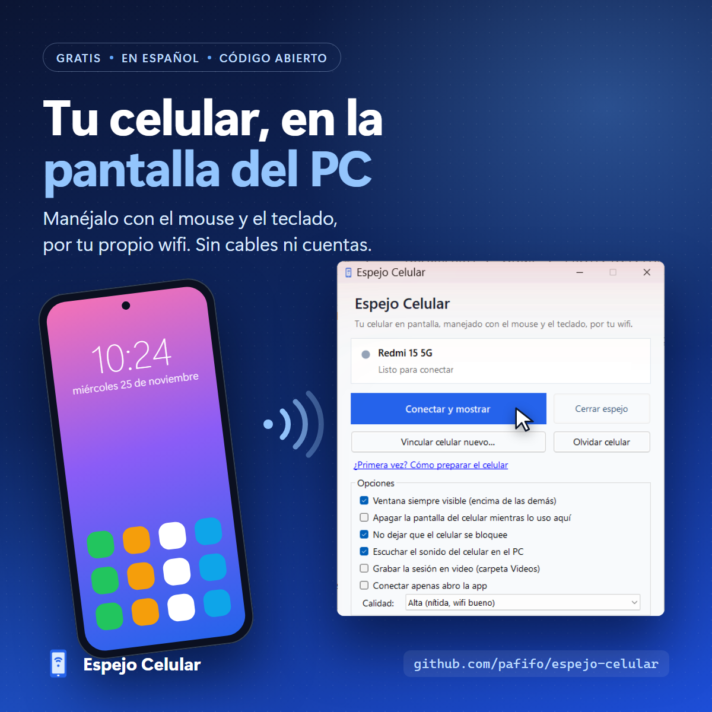
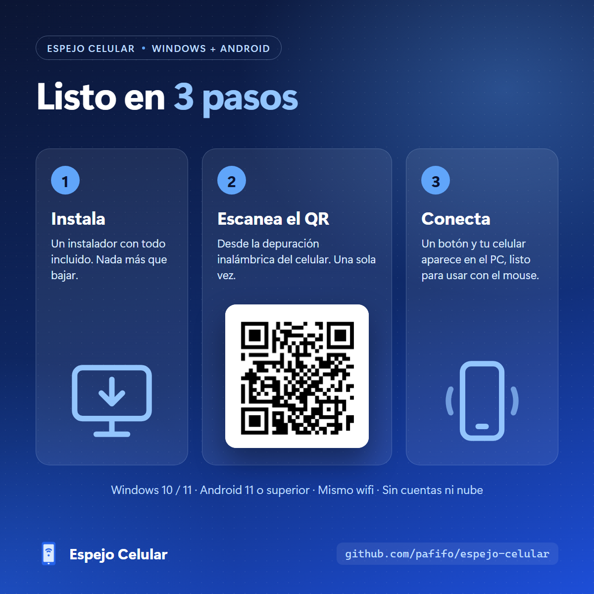

# Espejo Celular

**Tu celular Android en la pantalla del PC, manejado con el mouse y el teclado, por tu propio wifi.**
Gratis, en español, sin cuentas, sin internet y sin servidores de por medio.

### [⬇ Descargar el instalador para Windows](https://github.com/pafifo/espejo-celular/releases/latest)

 

---

## Qué hace

- Ves la pantalla del celular en una ventana del PC, en tiempo real.
- La manejas con el mouse (clic = tocar, rueda = deslizar, clic derecho = atrás) y escribes con el teclado del PC.
- Copiar y pegar entre el PC y el celular. Arrastra un `.apk` para instalarlo o un archivo para copiarlo.
- Sonido del celular en el PC y ventana siempre visible.
- Queda como ícono junto al reloj: la X solo esconde la ventana; con clic derecho en el ícono están las opciones, la captura, la grabación y «Salir». Opción para abrirla al iniciar Windows.
- Barra junto al espejo: **Copiar captura** (al portapapeles y a Imágenes), **Grabar** cuando quieras (video MP4 con sonido en Videos) **WhatsApp** (copia la captura y abre WhatsApp para pegarla en el chat) y **Mandar archivo** (del PC a Descargas del celular; los .apk se instalan; también arrastrando y soltando).
- Copiar y pegar texto entre el celular y el PC (Ctrl+C / Ctrl+V; Alt+Mayús+V escribe letra por letra donde no deja pegar).
- Ventana **Atajos y ayuda** con todas las teclas y clics para manejar el celular y qué hacer si algo falla.
- Se vincula **una sola vez** escaneando un código QR. Después, un botón: «Conectar y mostrar».
- Encuentra el celular solo en la red, aunque cambie su IP, su puerto o su MAC (Android cambia la MAC por privacidad y el router le da otra IP): lo busca por su nombre y, de respaldo, por su número de serie en el puerto fijo 5555.

## Requisitos

- Windows 10 u 11 de 64 bits.
- Android 11 o más nuevo.
- PC y celular en el mismo wifi.

## Cómo se usa

1. Instala con el instalador (trae todo lo necesario).
2. En el celular activa el **modo desarrollador** y la **depuración inalámbrica**. La app trae una guía paso a paso (Xiaomi, Samsung, Motorola y otros). En Xiaomi / Redmi / POCO activa también «Depuración USB (ajustes de seguridad)».
3. En la app pulsa **«Vincular celular nuevo…»** y escanea el QR desde el celular (Depuración inalámbrica › Vincular dispositivo con código QR). También se puede con un código de 6 números.
4. Pulsa **«Conectar y mostrar»**.

> Windows puede avisar «Windows protegió su PC» porque el instalador no está firmado: «Más información» › «Ejecutar de todas formas».

## Privacidad y seguridad

Todo viaja directo entre tu celular y tu PC dentro de tu red. No hay cuentas, nube ni telemetría. Solo los PC que vinculaste pueden conectarse, y puedes apagar la depuración inalámbrica cuando no la uses.

## Cómo funciona

Espejo Celular es una interfaz en español sobre [scrcpy](https://github.com/Genymobile/scrcpy), el excelente proyecto libre de Genymobile, que hace la transmisión de video y el control. Espejo Celular agrega la vinculación por QR, la búsqueda automática del celular en la red (mDNS), las opciones en pantalla y la guía para dejar el celular listo.

## Compilar desde el código

Requiere .NET 8 SDK, NSIS y scrcpy (`winget install Genymobile.scrcpy`).

```powershell
.\construir.ps1
```

Deja la app en `dist\` y el instalador en `distribucion\`.

- `EspejoCelular\` código C# WinForms (`MainForm`, `VincularForm`, `GuiaForm`, `Adb`, `Config`).
- `instalador.nsi` instalador NSIS (instala en Archivos de programa y abre en el firewall el UDP 5353 de adb para mDNS).

## Licencia

MIT. scrcpy se incluye bajo Apache 2.0 (ver `terceros/LICENCIA-scrcpy.txt`).

Hecho por Ojo Digital · [ojodigital.cl](https://ojodigital.cl).
